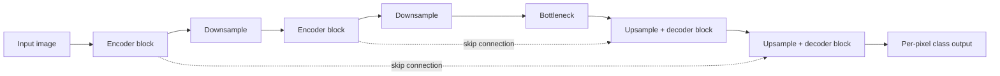
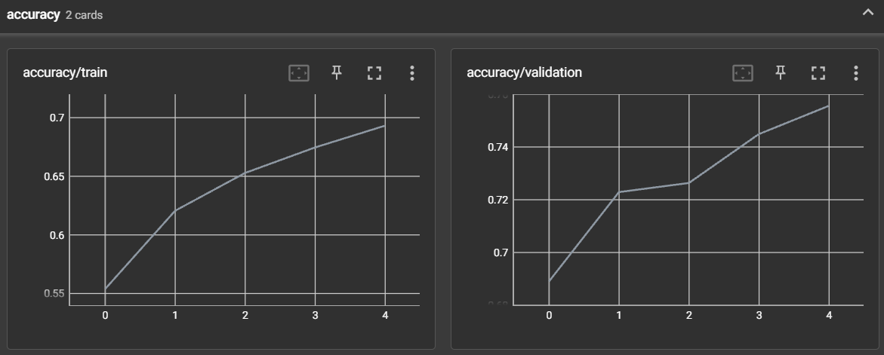
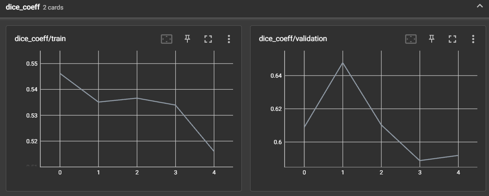
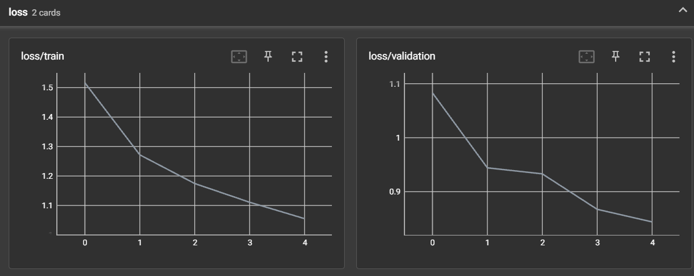
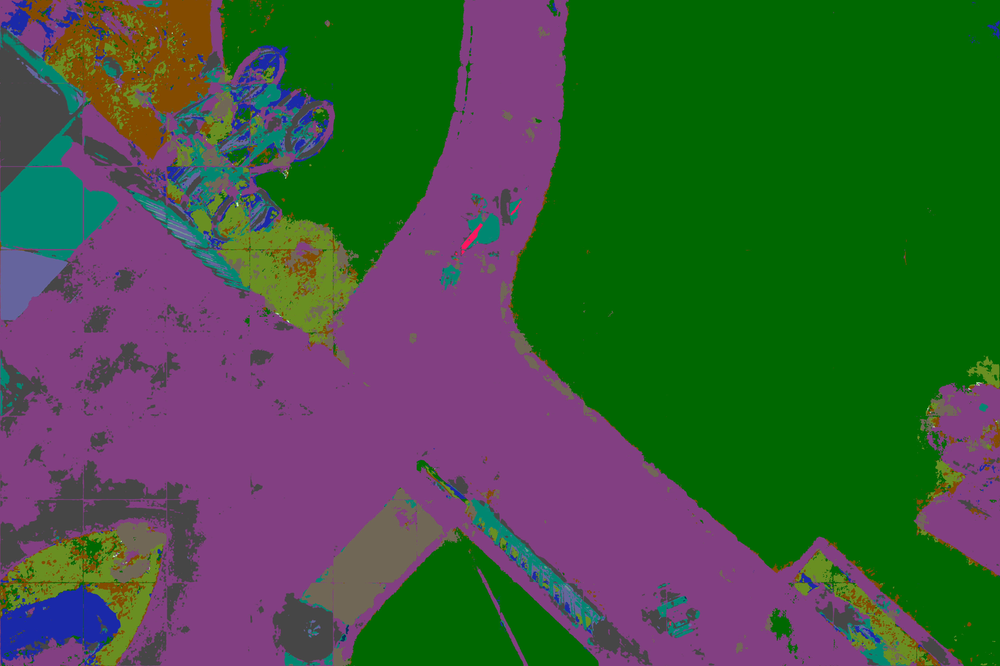

# U-Net Semantic Segmentation

## Description

This project implements a U-Net model for multi-class semantic segmentation.

The model was designed with reference to the original U-Net architecture by
Ronneberger, Fischer, and Brox. The network uses an encoding path to build
higher-level feature representations and a decoding path to recover spatial
resolution, with skip connections linking corresponding stages.

The Semantic Drone Dataset from Graz University of Technology's Institute of
Computer Graphics and Vision was used to train and evaluate the model. To work
within the available GPU memory, the original high-resolution images were
divided into smaller patches before training and testing. Prediction patches
could then be recombined into full-resolution segmentation maps.

## Results

Figure 1. model_v1 accuracy

Figure 2. model_v1 Dice coefficient

Figure 3. model_v1 loss

Figure 4. Semantic segmentation prediction for Semantic Drone Dataset image
#476. This is a dataset-derived result and is subject to the dataset terms
described below.

## Key Learnings

Training a semantic segmentation model on large images can be computationally
expensive. In this project, patchification allowed large images to be processed
within the available GPU memory.

A tradeoff was visible at patch boundaries. Pixels near patch edges had less
surrounding context, which produced lower-quality predictions and visible
gridline artifacts when the patches were recombined.

Possible improvements include overlap-tile processing, padding strategies, and
automatically selecting patch dimensions based on the network geometry.

## Dataset and Artifact Licensing

The Semantic Drone Dataset is not distributed as part of this project. It is
provided by Graz University of Technology for non-commercial use under its own
terms and requires attribution.

Source code authored for this repository is licensed under the MIT License,
except where otherwise noted.

Trained model checkpoints and dataset-derived outputs or evaluation artifacts
are not covered by the MIT License to the extent that the Semantic Drone
Dataset terms apply to them. See [THIRD_PARTY_NOTICES.md](THIRD_PARTY_NOTICES.md)
for details.

## Resources

- [Semantic Drone Dataset](https://ivc.tugraz.at/research-project/semantic-drone-dataset/), Institute of Computer Graphics and Vision, Graz University of Technology
- [U-Net: Convolutional Networks for Biomedical Image Segmentation](https://arxiv.org/abs/1505.04597), O. Ronneberger, P. Fischer, and T. Brox
- [Metrics to Evaluate your Semantic Segmentation Model](https://towardsdatascience.com/metrics-to-evaluate-your-semantic-segmentation-model-6bcb99639aa2), E. Tiu

## License

Except where otherwise noted, source code authored for this project is licensed
under the MIT License. See [LICENSE](LICENSE).

Third-party software, data, and dataset-derived artifacts remain subject to
their respective licenses and terms. See
[THIRD_PARTY_NOTICES.md](THIRD_PARTY_NOTICES.md).
